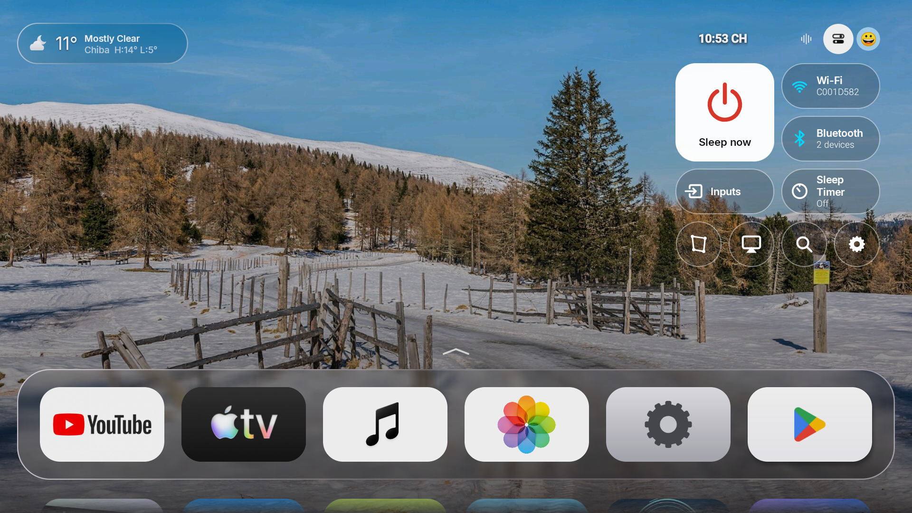
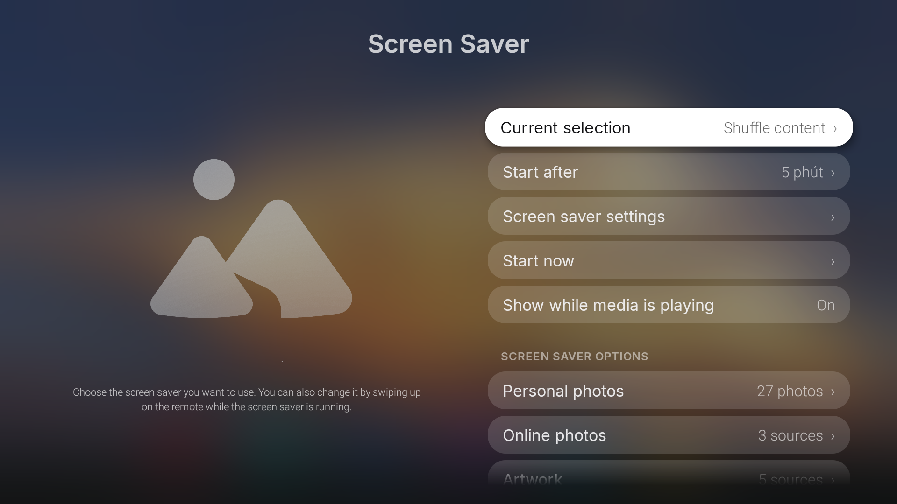

# tvOS Launcher for Android TV

  <strong>A More Personal Home for Your TV</strong>
   
  An elegant Android TV launcher inspired by APtvOS.

---

## ✨ About

Make your Android TV feel like yours. Arrange your apps, personalize the screen, and keep everyday controls close at hand.

## 🖼️ Explore the Launcher

<table>
  <tr>
    <td align="center" width="50%">
      
       <strong>Home Screen</strong>
    </td>
    <td align="center" width="50%">
      
       <strong>Control Center</strong>
    </td>
  </tr>
  <tr>
    <td align="center" width="50%">
      
       <strong>AirPlay</strong>
    </td>
    <td align="center" width="50%">
      
       <strong>Screen Saver</strong>
    </td>
  </tr>
  <tr>
    <td align="center" width="50%">
      
       <strong>Settings</strong>
    </td>
    <td align="center" width="50%">
      
       <strong>VPN</strong>
    </td>
  </tr>
</table>

## 🚀 Features

### Make It Your Home

Arrange apps in the dock and grid, hide apps you don’t use, and create profiles with their own names, avatars, and app order. Choose built-in scenes, personal photo slideshows, or online images from Amazon, Apple Aerial, and NASA. Customize image settings, appearance, fonts, and languages.

### Set the Scene

Add a Duo Clock and view local weather and forecasts. Real-time effects, including snowfall, bring the home screen to life. The multi-source screen saver displays images from personal and online collections while your TV is idle.

### Keep Controls Close

Use Control Center to access Wi-Fi, Bluetooth, memory information, the sleep timer, ambient mode, TV inputs, AirPlay, and more. Choose which shortcuts appear, assign supported apps or actions, and map remote buttons to single, double, triple, or long presses.

### Do More with Your TV

Stream to Android TV with AirPlay and a compatible companion app. Presentation Mode lets you send photos, videos, and web pages from another device on the same network.

### Manage Apps and Settings

Install supported APK and XAPK files, organize installed apps, and manage hidden or system apps. Back up and restore launcher settings, use supported VPN and DNS options, check for updates through GitHub, and automatically clear cache files to help free up storage.

---

## 🎯 Our Vision

We bring the visual elegance of APtvOS-inspired design to the flexibility of Android TV. The result is a home screen that feels personal, keeps favorite apps and everyday controls within reach, and makes the big screen more enjoyable throughout the day.

## 📦 Updates & Releases

Get official APK downloads, release notes, and update information on the [Releases page](https://github.com/zikkunmusic/BeHuyMup-tvOS-for-AndrTV/releases).

## 👥 Contributors

- **Project Maintainer:** Project direction, development, testing, and integration.
- **ChatGPT by OpenAI:** AI-assisted development, coding, debugging, and interface design.

## 🧩 Open-Source Projects

tvOS Launcher builds on the work of these open-source projects:

- [Hume Launcher](https://github.com/petrobot-admin/hume-launcher) — the original launcher codebase.
- [Couch TV](https://github.com/Seagey/couch-tv) and [CleanYourTV](https://github.com/Gathin23/cleanyourtv) — projects acknowledged in the development of the launcher.
- [Shield AirPlay](https://github.com/ebreen/shield-airplay) — an open-source AirPlay receiver that can be used as a compatible companion app.

See [NOTICE](NOTICE) for acknowledgements and license details.

## 🤝 Feedback & Contributions

Bug reports, suggestions, and feature requests are welcome. For updates, support, or contributions, get in touch:

  
  &nbsp;
  

---

  <strong>tvOS Launcher</strong>
   
  Make your TV experience uniquely yours.
   
  Made with love ❤️

