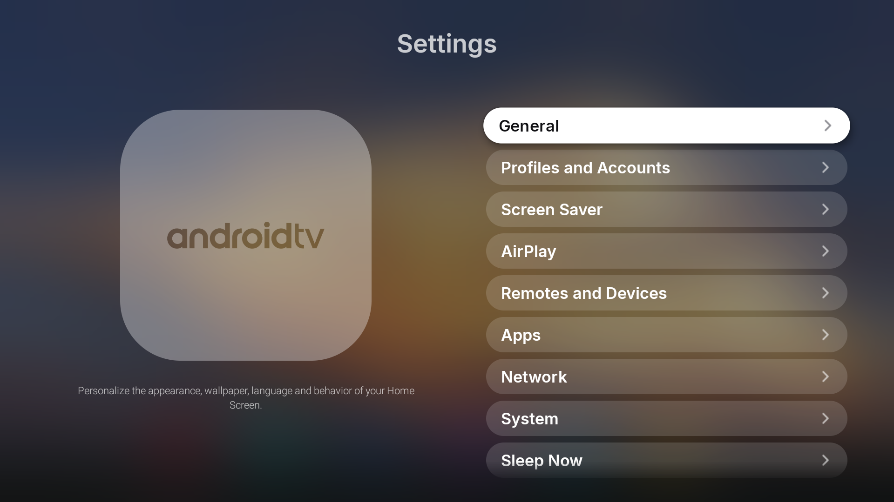

# tvOS Launcher for Android TV

<p align="center">
  <strong>A More Personal Home for Your TV</strong>
</p>

<p align="center">
  A refined Android TV launcher inspired by the look and feel of APtvOS.
</p>

<p align="center">
  
</p>

---

## ✨ About

Make your Android TV feel like yours. Choose your apps, create a look you love, and keep everyday controls close at hand.

## Features

### Make Home Yours

Arrange your app dock and grid. Choose built-in wallpapers, personal photo slideshows, or online images from sources including Amazon, Apple Aerial, and NASA. Profiles give each viewer their own app order and avatar.

### A More Immersive Screen

Set the mood with Duo Clock, live weather, seasonal effects, and a screen saver with images from multiple sources. Fine-tune image and appearance settings to suit your TV.

### Controls Within Reach

Use Control Center for Wi-Fi, Bluetooth, memory, sleep timer, TV inputs, AirPlay, and more. Customize shortcuts and map supported remote buttons to your favorite actions.

### More from Your TV

Stream with AirPlay using a compatible companion app. Presentation Mode lets you send photos, videos, and web pages to your TV from another device on the same network.

### Apps, Settings & Network

Install supported APK and XAPK files, organize apps, and use built-in backup and restore. Optional VPN and DNS tools are available in settings.

<p align="center">
  
</p>

---

## 🎯 Our Vision

A more personal, beautiful, and immersive way to enjoy Android TV.

## 📦 Updates & Releases

Get APK downloads and release notes on the [Releases page](https://github.com/zikkunmusic/tvOS-Launcher-for-Android-TV/releases).

## 👥 Contributors

- **Project Maintainer:** Direction, development, testing, and integration.
- **ChatGPT by OpenAI:** AI-assisted development, coding, debugging, and UI/UX design.

## 🤝 Feedback & Contributions

Bug reports, suggestions, and feature requests are welcome.

<p align="center">
  <sub>For contributions, updates, bug reports, and support, feel free to contact me:</sub>
</p>

<p align="center">
  <a href="https://t.me/behuymup">
    
  </a>
  &nbsp;
  <a href="mailto:75carotid.freeze@icloud.com">
    
  </a>
</p>

---

<p align="center">
  <strong>tvOS Launcher</strong>
  <br/>
  <sub>Make your TV experience uniquely yours.</sub>
  <br/>
  <sub>Made with love ❤️</sub>
</p>
```
