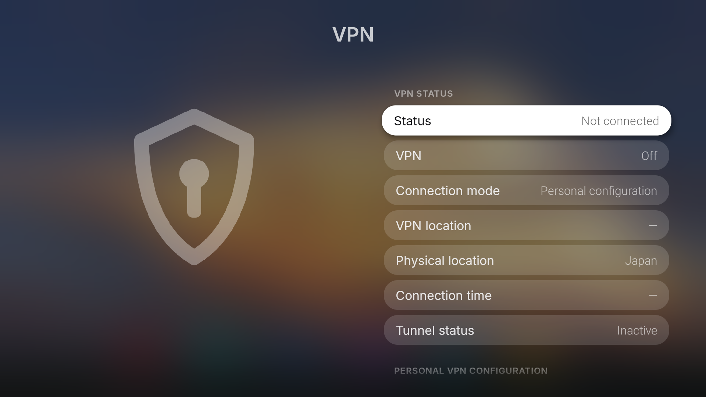

  <h1>tvOS Launcher for Android TV</h1>
  

    <strong>A More Personal Home for Your TV</strong> 
    An elegant Android TV launcher inspired by APtvOS.
  

  

    Make your TV feel like yours. Arrange your apps, personalize the screen,
    and keep everyday controls close at hand.
  

  

    <strong>Personalized home screen</strong> &nbsp;·&nbsp;
    <strong>Remote-friendly controls</strong> &nbsp;·&nbsp;
    <strong>Wallpapers, weather, and more</strong>
  

<h2>✨ About</h2>

  tvOS Launcher gives Android TV and Google TV a welcoming home screen built
  around the apps and features you use every day. Organize apps in a dock and
  grid, set up profiles, choose a look for your screen, and open useful TV
  controls with your remote.

  It brings together personalization, weather, screen saver settings,
  presentation tools, app management, and optional VPN features. Available
  features can depend on your TV model, Android version, installed apps, and
  network connection.

<h2 align="center">🖼️ Explore the Launcher</h2>

<table align="center" width="100%">
  <tr>
    <td width="58%" valign="middle">
      <h3>Make the Home Screen Yours</h3>
      

        Arrange apps in the dock and grid, change their order, and hide apps
        you do not use. Create profiles with their own names, avatars, and app
        layouts, so each person can have a home screen that suits them.
      

      

        Built-in scenes, personal photos, and supported online sources give
        you ways to make the background your own.
      

    </td>
    <td width="42%" align="center" valign="middle">
      
       Home screen with wallpaper, weather, and app dock
    </td>
  </tr>
</table>

<table align="center" width="100%">
  <tr>
    <td width="58%" valign="middle">
      <h3>Choose Your Background</h3>
      

        Use built-in scenes, photos from your TV, personal slideshows, or
        supported Internet wallpaper sources. Image settings help you choose
        how pictures appear on the screen.
      

      

        Show local weather and forecasts, then add optional live effects such
        as snowfall to the home screen.
      

    </td>
    <td width="42%" align="center" valign="middle">
      
       App dock displayed over a selected background
    </td>
  </tr>
</table>

<table align="center" width="100%">
  <tr>
    <td width="58%" valign="middle">
      <h3>Keep Controls Close</h3>
      

        Open Control Center for shortcuts to supported TV controls, including
        Wi-Fi, Bluetooth, TV inputs, audio, sleep timer, AirPlay, and search.
      

      

        Choose which shortcuts appear and map supported remote buttons to
        single, double, triple, or long-press actions. Available controls vary
        by device.
      

    </td>
    <td width="42%" align="center" valign="middle">
      
       Control Center shortcuts on the home screen
    </td>
  </tr>
</table>

<table align="center" width="100%">
  <tr>
    <td width="58%" valign="middle">
      <h3>Make Idle Time Feel Better</h3>
      

        Configure the TV screen saver and choose how the launcher behaves
        when the TV is idle. The home carousel can surface recommendations and
        news, while screen saver options are managed from Settings.
      

      

        Personal photos and supported online image sources can also be used
        for slideshow features.
      

    </td>
    <td width="42%" align="center" valign="middle">
      
       Screen saver while the TV is idle
    </td>
  </tr>
</table>

<table align="center" width="100%">
  <tr>
    <td width="58%" valign="middle">
      <h3>Connect and Present</h3>
      

        Use AirPlay with a compatible receiver companion app to send supported
        audio, video, or screen content to Android TV. The receiver app is
        installed separately and is not bundled with the launcher.
      

      

        Presentation Mode lets you send photos, videos, and web pages from a
        phone or computer on the same local network.
      

    </td>
    <td width="42%" align="center" valign="middle">
      
       AirPlay settings for a compatible receiver app
    </td>
  </tr>
</table>

<table align="center" width="100%">
  <tr>
    <td width="58%" valign="middle">
      <h3>Manage Apps and Settings</h3>
      

        Install supported APK and XAPK files, organize installed apps, and
        manage hidden or system apps. Back up and restore launcher settings,
        check for updates, and use automatic cache cleanup.
      

      

        Settings brings together profiles, screen saver options, AirPlay
        controls, network features, and other device-specific options.
      

    </td>
    <td width="42%" align="center" valign="middle">
      
       Launcher settings and device options
    </td>
  </tr>
</table>

<table align="center" width="100%">
  <tr>
    <td width="58%" valign="middle">
      <h3>Optional VPN Features</h3>
      

        Use the supported VPN features to manage profiles and connections on
        compatible Android TV devices. VPN availability and behavior depend
        on the device and selected VPN configuration.
      

      
See the integrated VPN guide for setup information and device notes.

    </td>
    <td width="42%" align="center" valign="middle">
      
       VPN settings
    </td>
  </tr>
</table>

<h2>🌐 Languages and Compatibility</h2>

  The interface is available in English, Vietnamese, Japanese, Chinese,
  Hindi, Spanish, Thai, Korean, French, and Russian. The app targets Android
  7.0 (API 24) and newer. Device support can vary by manufacturer, Android
  release, system components, and remote-control behavior.

<h2>🧩 Open-Source Code and Credits</h2>

  The source tree records the projects and components below. The exact
  upstream revision or file-by-file reuse map is unavailable for some
  entries; see the <a href="LICENSE-AUDIT.md">license audit</a> for details.
  Full notices and license texts are available in
  <a href="THIRD-PARTY-NOTICES.md">Third-Party Notices</a> and
  <a href="assets/legal/">assets/legal/</a>.

<h3>Source Code and Bundled Components</h3>

<ul>
  <li>
    <a href="https://github.com/petrobot-admin/hume-launcher"><strong>Hume Launcher</strong></a>
    — the launcher codebase this project identifies as its starting point.
    Apache License 2.0.
  </li>
  <li>
    <a href="https://github.com/techgenius1/tvOS-Launcher"><strong>tvOS Launcher upstream</strong></a>
    — upstream project lineage recorded in the project NOTICE. Apache
    License 2.0; the exact imported revision and file mapping are unavailable
    in this checkout.
  </li>
  <li>
    <a href="https://github.com/Gathin23/cleanyourtv"><strong>CleanYourTV</strong></a>
    — source for bundled TV device cleanup profiles and related safety rules.
    MIT License.
  </li>
  <li>
    <a href="https://github.com/nayuki/QR-Code-generator"><strong>Project Nayuki QR Code Generator</strong></a>
    — Java QR code source in <code>src/io/nayuki/qrcodegen/</code>. MIT
    License.
  </li>
  <li>
    <a href="https://github.com/rsms/inter"><strong>Inter</strong></a>
    — bundled Inter and Inter Display font files. SIL Open Font License 1.1.
  </li>
  <li>
    <a href="https://github.com/OpenVPN/openvpn3"><strong>OpenVPN 3 Core</strong></a>
    — native VPN runtime, Mozilla Public License 2.0. The Android AAR and
    dependency versions are listed in
    <a href="libs/openvpn/NOTICE.md"><code>libs/openvpn/NOTICE.md</code></a>;
    the <a href="https://central.sonatype.com/artifact/io.github.tim06/openvpn">Maven Central record</a>
    identifies the OpenVPN Android package.
  </li>
  <li>
    <strong>Kotlin, AndroidX, and Okio</strong> — bundled dependencies used
    by the OpenVPN Android components. See component versions in
    <a href="libs/openvpn/NOTICE.md"><code>libs/openvpn/NOTICE.md</code></a>.
    Source projects:
    <a href="https://github.com/JetBrains/kotlin">Kotlin</a>,
    <a href="https://github.com/Kotlin/kotlinx.coroutines">Kotlin Coroutines</a>,
    <a href="https://github.com/androidx/androidx">AndroidX</a>, and
    <a href="https://github.com/square/okio">Okio</a>.
  </li>
</ul>

<h3>Asset with Separate Use Restrictions</h3>

<ul>
  <li>
    <a href="https://github.com/npwitk/Macintosh-Skeletal-Filled"><strong>Macintosh Skeletal Filled</strong></a>
    — source of Macintosh-derived stroke data used for the setup greeting.
    The included source terms limit use to personal, non-commercial,
    educational purposes; permission for public APK redistribution is not
    established. See the <a href="LICENSE-AUDIT.md">license audit</a> before
    redistribution.
  </li>
</ul>

<h3>Acknowledged References and Companion Apps</h3>

<ul>
  <li>
    <a href="https://github.com/Seagey/couch-tv">Couch TV</a> and
    <a href="https://github.com/jhao941/McIntosh-Writer">McIntosh Writer</a>
    are acknowledged references. This checkout does not establish that their
    code is included in the app.
  </li>
  <li>
    <a href="https://github.com/jqssun/android-airplay-server">Android AirPlay Server</a>
    is a separate compatible receiver app described in the install guide. It
    is not bundled with tvOS Launcher.
  </li>
</ul>

<h3>Runtime Data Services</h3>

  These services provide data or media at runtime; their server code and
  returned content have separate terms. Check each provider’s current
  conditions and the attribution shown in the app.

<ul>
  <li>
    Weather: <a href="https://open-meteo.com/">Open-Meteo</a>,
    <a href="https://api.met.no/">MET Norway</a>, and
    <a href="https://github.com/chubin/wttr.in">wttr.in</a>.
  </li>
  <li>
    Artwork and wallpaper sources include museum collections,
    <a href="https://commons.wikimedia.org/">Wikimedia Commons</a>,
    <a href="https://openverse.org/">Openverse</a>,
    <a href="https://images.nasa.gov/">NASA</a>,
    <a href="https://www.bing.com/">Bing</a>, Apple Aerials, Amazon’s image
    catalog, and the project’s
    <a href="https://github.com/behuymup/tvOSLauncher-for-AndroidTV/tree/main/Wallpaper">wallpaper repository</a>.
  </li>
  <li>
    Other network features use news feeds, entertainment metadata services,
    geolocation providers, and VPN Gate. Details are in the source and the
    in-app legal information.
  </li>
</ul>

<h2>📚 Documentation</h2>

<ul>
  <li><a href="docs/getting-started.md">Getting started</a></li>
  <li><a href="docs/features.md">Feature guide</a></li>
  <li><a href="docs/install.md">Install and permissions</a></li>
  <li><a href="docs/presentation.md">Presentation Mode</a></li>
  <li><a href="docs/vpn.md">Integrated VPN</a></li>
  <li><a href="docs/architecture.md">Architecture</a></li>
  <li><a href="docs/tv-performance-qa.md">TV focus and performance QA</a></li>
  <li><a href="CONTRIBUTING.md">Contributing</a></li>
  <li><a href="LICENSE-AUDIT.md">License audit</a></li>
  <li><a href="THIRD-PARTY-NOTICES.md">Third-party notices</a></li>
</ul>

<h2>🛠️ Build</h2>

  Requirements: JDK 17 or newer, Android SDK Build Tools <code>35.0.0</code>,
  platform <code>android-36</code>, and the SDK’s R8 tool (the defaults in
  <code>build.sh</code>). Release builds require the maintainer release
  keystore. R8 shrinks unused dependency code in both variants and obfuscates
  app-owned names in Release while preserving Android and reflection entry
  points. Debug builds retain app-owned names for local debugging. Set
  <code>ENABLE_R8=0</code> to use D8 for diagnostics. Override SDK versions
  with <code>BUILD_TOOLS_VERSION</code> and <code>COMPILE_SDK_VERSION</code>
  when using another installed SDK.

From macOS or Linux:

<pre><code>RELEASE_KEYSTORE=/path/to/tvos-release.jks RELEASE_KEYSTORE_PASS=... VERSION_CODE=... VERSION_NAME=... ./build.sh</code></pre>

  For local development, run <code>BUILD_VARIANT=debug ./build.sh</code>;
  debug APKs cannot update release installs and should not be distributed.
  The signed APK is written to <code>build/tvos-home.apk</code>; the build
  code increments from the existing output unless <code>VERSION_CODE</code>
  is set. Intermediate files are removed after a successful build; set
  <code>KEEP_BUILD_INTERMEDIATES=1</code> to retain them. See
  <a href="docs/getting-started.md">Getting started</a> for SDK setup and
  install steps. On Windows, use <code>build.ps1</code> with the same
  <code>RELEASE_KEYSTORE</code> and <code>RELEASE_KEYSTORE_PASS</code>
  variables for releases, or <code>BUILD_VARIANT=debug</code> for development.

<h2>⚖️ License</h2>

  The root <a href="LICENSE">LICENSE</a> and <a href="NOTICE">NOTICE</a>
  preserve the project’s Apache-2.0 terms and upstream credits. Third-party
  components have their own licenses and notices; review the
  <a href="LICENSE-AUDIT.md">license audit</a> and
  <a href="THIRD-PARTY-NOTICES.md">Third-Party Notices</a> before
  redistributing the app or its source.

  <strong>tvOS Launcher</strong>
   
  Make your TV experience uniquely yours.

