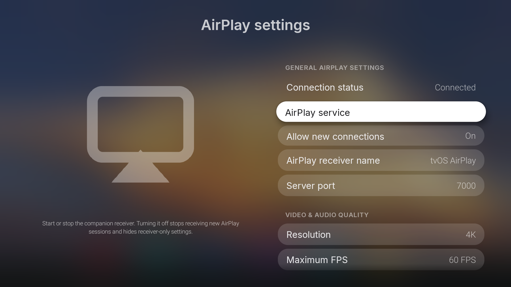

<h1 align="center">tvOS Launcher for Android TV</h1>

  <strong>A More Personal Home for Your TV</strong>
   
  An elegant Android TV launcher inspired by APtvOS.

  
  &nbsp;
  

<h2>✨ About</h2>

  Make your Android TV feel like yours. tvOS Launcher brings an APtvOS-inspired
  look to Android TV, with a home screen you can personalize around your apps,
  your photos, and the way you use your television.

  Arrange apps, create profiles, choose wallpapers, check local weather, and
  keep everyday controls close at hand. Control Center brings supported TV
  functions and launcher shortcuts together in one place, while the screen
  saver can display personal photos and supported online collections.

  Designed for the big screen and remote control, tvOS Launcher keeps favorite
  apps and useful features easy to find throughout the day.

<h2>🌟 Launcher Highlights</h2>

<table width="100%">
  <tr>
    <td width="33%" valign="top">
      <h3>🏠 Personal Home</h3>
      

        Arrange your apps, choose a background, and create profiles with their
        own names, avatars, and app order.
      

    </td>
    <td width="33%" valign="top">
      <h3>🎛️ Quick Controls</h3>
      

        Reach supported TV settings, launcher shortcuts, and remote actions
        through Control Center.
      

    </td>
    <td width="33%" valign="top">
      <h3>🌌 Your Screen Saver</h3>
      

        Display personal photos and supported image collections while your TV
        is idle.
      

    </td>
  </tr>
</table>

<h2 align="center">🖼️ Explore the Launcher</h2>

<h3>🚀 Get Started</h3>

  Set up the launcher on your TV and choose the initial options that work for
  your device and preferences.

<table width="100%">
  <tr>
    <td width="50%" align="center" valign="top">
      
       
      <strong>Begin Setup</strong>
    </td>
    <td width="50%" align="center" valign="top">
      
       
      <strong>Choose Your Options</strong>
    </td>
  </tr>
</table>

<h3>🏡 Personalize Your Home</h3>

<table width="100%">
  <tr>
    <td width="58%" valign="middle">
      <h4>Home Screen</h4>
      

        Keep your favorite apps front and center. Arrange apps in the dock and
        grid, select a background, and view useful information such as local
        weather from your home screen.
      

      

        Choose a layout that works for your TV and make the launcher feel like
        your own.
      

    </td>
    <td width="42%" align="center">
      
    </td>
  </tr>

  <tr>
    <td width="42%" align="center">
      
    </td>
    <td width="58%" valign="middle">
      <h4>Launcher Settings</h4>
      

        Adjust the launcher’s appearance and behavior from its settings.
        Personalize available image options, fonts, and other preferences for
        your TV.
      

    </td>
  </tr>

  <tr>
    <td width="58%" valign="middle">
      <h4>Language Options</h4>
      

        Choose from the available language options to make launcher menus and
        settings easier to use.
      

    </td>
    <td width="42%" align="center">
      
    </td>
  </tr>
</table>

<h3>🎛️ Control Your TV</h3>

<table width="100%">
  <tr>
    <td width="58%" valign="middle">
      <h4>Control Center</h4>
      

        Open frequently used controls from one place. Depending on your TV and
        connected devices, Control Center can provide access to Wi-Fi,
        Bluetooth, memory information, sleep timer, ambient mode, TV inputs,
        AirPlay, and other shortcuts.
      

    </td>
    <td width="42%" align="center">
      
    </td>
  </tr>

  <tr>
    <td width="42%" align="center">
      
    </td>
    <td width="58%" valign="middle">
      <h4>Control Center Settings</h4>
      

        Choose which supported controls and shortcuts appear in Control Center.
        Keep the actions you use most within easy reach.
      

    </td>
  </tr>

  <tr>
    <td width="58%" valign="middle">
      <h4>Remote and Devices</h4>
      

        Review supported remote and device options. Map supported remote
        buttons to single, double, triple, or long-press actions.
      

    </td>
    <td width="42%" align="center">
      
    </td>
  </tr>
</table>

<h3>📦 Manage Apps and Connections</h3>

<table width="100%">
  <tr>
    <td width="42%" align="center">
      
    </td>
    <td width="58%" valign="middle">
      <h4>Apps</h4>
      

        Organize installed apps and control which apps appear in the launcher.
        Hide apps you do not use, manage supported system apps, and install
        supported APK and XAPK files.
      

    </td>
  </tr>

  <tr>
    <td width="58%" valign="middle">
      <h4>Network</h4>
      

        Find supported network options and related settings. Available controls
        depend on the Android TV device and its software.
      

    </td>
    <td width="42%" align="center">
      
    </td>
  </tr>

  <tr>
    <td width="42%" align="center">
      
    </td>
    <td width="58%" valign="middle">
      <h4>VPN</h4>
      

        Access supported VPN options from the launcher’s settings. Available
        functions depend on the selected VPN configuration and the TV device.
      

    </td>
  </tr>
</table>

<h3>🎬 Enjoy and Share Content</h3>

<table width="100%">
  <tr>
    <td width="58%" valign="middle">
      <h4>AirPlay</h4>
      

        Stream supported content to Android TV with AirPlay and a compatible
        companion receiver. AirPlay-related controls are available where
        supported by the installed app and device.
      

    </td>
    <td width="42%" align="center">
      
    </td>
  </tr>

  <tr>
    <td width="42%" align="center">
      
    </td>
    <td width="58%" valign="middle">
      <h4>Screen Saver</h4>
      

        Turn an idle TV into a photo display. The multi-source screen saver can
        show personal images and supported online collections while your TV is
        not in use.
      

    </td>
  </tr>
</table>

<h2>🚀 Features</h2>

<h3>Make It Your Home</h3>
<ul>
  <li>Arrange apps in the dock and home screen grid.</li>
  <li>Hide apps you do not want to show on the home screen.</li>
  <li>Create profiles with their own names and avatars.</li>
  <li>Set a different app order for each profile.</li>
  <li>Choose built-in scenes or personal photo slideshows.</li>
  <li>Customize available image, appearance, font, and language options.</li>
</ul>

<h3>Set the Scene</h3>
<ul>
  <li>Add a Duo Clock to the home screen.</li>
  <li>View local weather and forecasts.</li>
  <li>Choose supported online image collections, including Amazon, Apple Aerial, and NASA.</li>
  <li>Enjoy real-time visual effects, including snowfall.</li>
  <li>Display personal and online images in the multi-source screen saver.</li>
</ul>

<h3>Keep Controls Close</h3>
<ul>
  <li>Open supported Wi-Fi and Bluetooth controls.</li>
  <li>View memory information and use the sleep timer.</li>
  <li>Access ambient mode, TV inputs, AirPlay, and other supported shortcuts.</li>
  <li>Choose which shortcuts appear in Control Center.</li>
  <li>Assign supported actions to remote button presses.</li>
</ul>

<h3>Do More with Your TV</h3>
<ul>
  <li>Stream to Android TV with AirPlay and a compatible companion app.</li>
  <li>Use Presentation Mode to send photos, videos, and web pages from another device on the same network.</li>
</ul>

<h3>Manage Apps and Settings</h3>
<ul>
  <li>Install supported APK and XAPK files.</li>
  <li>Organize installed apps and manage hidden or system apps.</li>
  <li>Back up and restore launcher settings.</li>
  <li>Use supported VPN and DNS options.</li>
  <li>Check for launcher updates through GitHub.</li>
  <li>Automatically clear cache files to help free up storage.</li>
</ul>

<h2>🎯 Our Vision</h2>

  We bring the visual elegance of APtvOS-inspired design to the flexibility of
  Android TV. The result is a home screen that feels personal, keeps favorite
  apps and everyday controls within reach, and makes the big screen more
  enjoyable throughout the day.

<h2>📥 Updates &amp; Releases</h2>

  Get official APK downloads, release notes, and update information on the
  <a href="https://github.com/behuymup/tvOSLauncher-for-AndroidTV/releases">GitHub Releases page</a>.

<h2>🧩 Open-Source Acknowledgements</h2>

  tvOS Launcher acknowledges the open-source projects and components listed
  below. See the project notices for acknowledgements and license details.

<ul>
  <li>
    <a href="https://github.com/petrobot-admin/hume-launcher">Hume Launcher</a>
    — the original launcher codebase acknowledged by this project.
  </li>
  <li>
    <a href="https://github.com/Seagey/couch-tv">Couch TV</a>
    — an open-source project acknowledged during development.
  </li>
  <li>
    <a href="https://github.com/Gathin23/cleanyourtv">CleanYourTV</a>
    — an open-source project acknowledged during development.
  </li>
  <li>
    <a href="https://github.com/Nayuki/QR-Code-generator">Project Nayuki QR Code</a>
    — an open-source QR code project.
  </li>
  <li>
    <a href="https://github.com/ebreen/shield-airplay">Shield AirPlay</a>
    — an open-source AirPlay receiver that can be used as a compatible companion app.
  </li>
</ul>

  See <a href="NOTICE">NOTICE</a> and
  <a href="THIRD-PARTY-NOTICES.md">THIRD-PARTY-NOTICES.md</a>
  for third-party acknowledgements and license details.

<h2>👥 Contributors</h2>

<ul>
  <li>
    <strong>Project Maintainer:</strong>
    Project direction, development, testing, and integration.
  </li>
  <li>
    <strong>ChatGPT by OpenAI:</strong>
    AI-assisted development, coding, debugging, and interface design.
  </li>
</ul>

<h2>🤝 Feedback &amp; Contributions</h2>

  Bug reports, suggestions, and feature requests are welcome. For updates,
  support, or contributions, get in touch:

  
  &nbsp;
  

  <strong>tvOS Launcher</strong>
   
  Make your TV experience uniquely yours.
   
  Made with love ❤️

