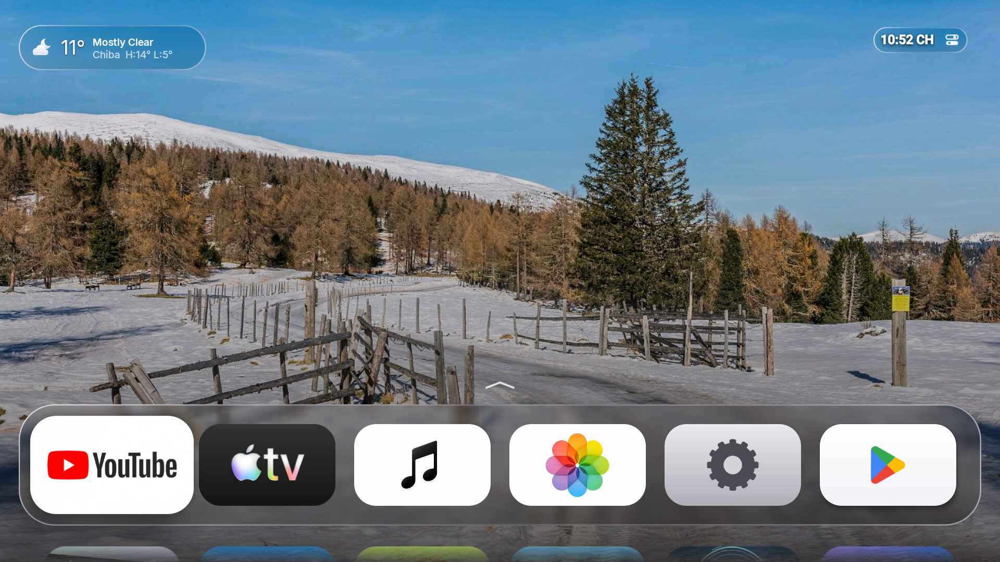

# tvOS Launcher for Android TV

<p align="center">
  <strong>A Premium APtvOS-Inspired Experience</strong>
</p>

<p align="center">
  A customizable Android TV launcher with immersive visuals, useful everyday controls, and a polished big-screen interface.
</p>

<p align="center">
  
</p>

---

## ✨ About

**tvOS Launcher** reimagines the Android TV home screen with a visual style inspired by **APtvOS** and the flexibility to make it your own.

Arrange your apps, choose the look of your screen, check the weather, and access useful controls from one place. Create personal profiles, explore a multi-source screensaver, and fine-tune the launcher to suit your TV.

## 🚀 Special Features

- **Personalized Home Screen:** Organize your app dock and grid, hide apps you don't use, and tailor the layout to your preferences.
- **Multiple Wallpaper Sources:** Choose built-in scenes, personal photo slideshows, or online images from sources such as Amazon, Apple Aerial, and NASA.
- **Image & Appearance Settings:** Adjust visual options, background themes, wallpaper presentation, and other home screen details.
- **Duo Clock:** Add a distinctive dual-clock layout to your home screen.
- **Weather & Seasonal Effects:** View local weather and forecasts, with live visual effects including snowfall.
- **Multi-Source Screen Saver:** Turn idle time into a photo experience with images from personal and online sources.
- **Control Center:** Quickly access Wi-Fi, Bluetooth, memory information, sleep timer, ambient mode, TV inputs, AirPlay, and other shortcuts.
- **Customizable Shortcuts:** Choose which Control Center icons appear and assign supported apps or actions to shortcuts.
- **Remote Button Mapping:** Set actions for supported remote buttons, including double presses, triple presses, and long presses.
- **Profiles for Everyone:** Create profiles with their own names, avatars, app order, and supported Continue Watching content.
- **App Management:** Install supported APK and XAPK files, organize installed apps, and manage hidden or system apps.
- **Backup & Restore:** Export launcher settings and restore them when needed.
- **Built-in AirPlay Support:** Use a compatible companion app to stream to your Android TV.
- **Photo Frame & Presentation Mode:** Send photos, videos, and web pages to the TV from another device on the same network.
- **Network Tools:** Access supported VPN and DNS options from the launcher settings.
- **Custom Fonts & Languages:** Personalize interface fonts and use the launcher in multiple languages.
- **Performance & Settings Improvements:** Enjoy a more responsive experience and a reorganized settings interface.

<p align="center">
  
</p>

---

## 🎯 Our Vision

To bring together the visual elegance of APtvOS-inspired design and the flexibility of Android TV, creating a more personal, beautiful, and immersive television experience.

## 📦 Updates & Releases

This repository provides official APK downloads, release notes, and update information.

Visit **[Releases](https://github.com/zikkunmusic/tvOS-Launcher-for-Android-TV/releases)** to get the latest version of tvOS Launcher.

## 👥 Contributors

- **Project Maintainer:** Project direction, development, testing, and final integration.
- **ChatGPT by OpenAI:** AI-assisted development, software architecture, coding, debugging, and UI/UX design.

## 🤝 Feedback & Contributions

Bug reports, suggestions, and feature requests are welcome.

<p align="center">
  <sub>For contributions, updates, bug reports, and support, feel free to contact me:</sub>
</p>

<p align="center">
  <a href="https://t.me/behuymup">
    
  </a>
  &nbsp;
  <a href="mailto:75carotid.freeze@icloud.com">
    
  </a>
</p>

---

<p align="center">
  <strong>tvOS Launcher</strong>
  <br/>
  <sub>Make your TV experience uniquely yours.</sub>
  <br/>
  <sub>Made with love ❤️</sub>
</p>
```
